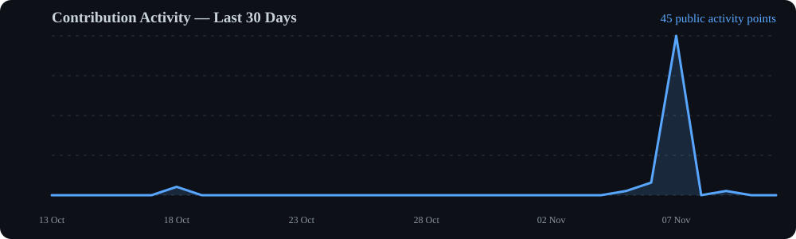
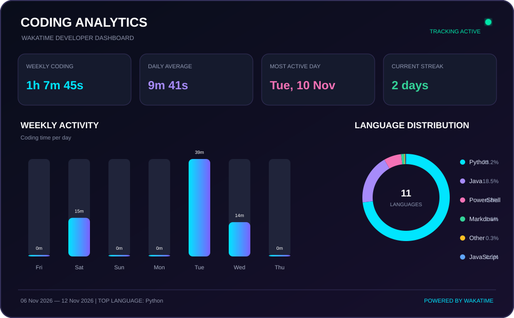
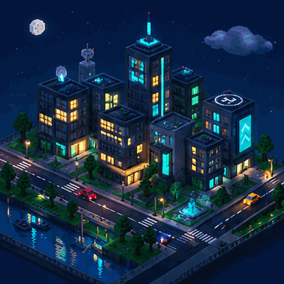

<div align="center">


<br/>


<br/><br/>


</div>

---

<div align="center">

# ◈ 01 — SYSTEM PROFILE

<sub>IDENTITY • OBJECTIVES • DEVELOPER OVERVIEW</sub>

</div>

<table>
<tr>
<td width="60%" valign="top">

### 👨‍💻 About Me

```yaml
Name: Surya Shekhar Bose
Role: Full Stack Developer
Education: B.Tech Information Technology
Achievement: 1x Hackathon Winner

Currently_Learning:
  - Java
  - Spring Boot
  - Full Stack Development

Currently_Building:
  - Hackathon Sim
  - Personal Projects

Interests:
  - Programming
  - Technology
  - Gaming
  - Innovation
```

- 🎓 B.Tech Information Technology student.
- 💻 Exploring Java, Spring Boot and Full Stack Development.
- 🚀 Building Hackathon Sim and personal projects.
- 🏆 1× Hackathon Winner.
- 🌱 Always exploring new technologies.
- 🎮 Gamer when I'm not coding.

</td>
<td width="40%" align="center" valign="middle">


<br/><br/>

**BUILD. LEARN. INNOVATE.**

<sub>Turning caffeine into code.</sub>

<br/><br/>


</td>
</tr>
</table>

---

<div align="center">

# ◈ 02 — TECHNOLOGY ARSENAL

<sub>TOOLS • LANGUAGES • FRAMEWORKS • PLATFORMS</sub>

</div>

<table>
<tr>
<td width="50%" align="center" valign="top">

### ⚡ Programming Languages


</td>
<td width="50%" align="center" valign="top">

### 🎨 Frontend Development


</td>
</tr>
<tr>
<td width="50%" align="center" valign="top">

### ⚙️ Backend & Database


</td>
<td width="50%" align="center" valign="top">

### 🛠️ Tools & Platforms


</td>
</tr>
</table>

---

<div align="center">

# ◈ 03 — GITHUB PERFORMANCE

<sub>MY DEVELOPMENT STATISTICS</sub>

<br/><br/>


</div>

---


<div align="center">

# ◈ 04 — ACHIEVEMENTS UNLOCKED

<sub>GITHUB TROPHIES • MILESTONES • CONTRIBUTIONS</sub>

<br/><br/>


</div>

---


<div align="center">

# ◈ 05 — CONTRIBUTION MATRIX

<sub>VISUAL REPRESENTATION OF MY DEVELOPMENT ACTIVITY</sub>

<br/><br/>



</div>

---

<div align="center">

# ◈ 06 — CONTRIBUTION CALENDAR

<sub>EVERY CONTRIBUTION IS ANOTHER STEP FORWARD</sub>

<br/><br/>


</div>

---

<div align="center">

# ◈ 07 — CONTRIBUTION SNAKE

<sub>WATCH MY CONTRIBUTIONS GET EATEN!</sub>

<br/><br/>


</div>

---

<div align="center">

# ◈ 08 — CODING ACTIVITY

<sub>REAL-TIME DEVELOPMENT INSIGHTS • POWERED BY WAKATIME</sub>

<br/>


<br/><br/>

<!--START_SECTION:waka-->

<div align="center">
  
</div>

<!--END_SECTION:waka-->

<br/>

<sub>Automatically updated through GitHub Actions.</sub>

</div>

---

<div align="center">

# ◈ 09 — FEATURED PROJECTS

<sub>SELECTED BUILDS • EXPERIMENTS • CREATIVE DEVELOPMENT</sub>

</div>

<table>
<tr>
<td width="50%" align="center" valign="top">

### 🎮 Rock Paper Scissors


**INTERACTIVE GAME PROJECT**

A fun game built with interactive gameplay.

<br/>

<a href="https://github.com/suryadev111/rock_paper_scissors">

</a>

</td>
<td width="50%" align="center" valign="top">

### ❌ Tic Tac Toe


**CLASSIC STRATEGY GAME**

A simple and entertaining Tic Tac Toe project.

<br/>

<a href="https://github.com/suryadev111/Tic-Tac-Toe">

</a>

</td>
</tr>
</table>

<div align="center">

<br/>

<a href="https://github.com/suryadev111?tab=repositories">

</a>

</div>

---

<div align="center">

# ◈ 10 — MY DIGITAL UNIVERSE

<sub>CREATIVITY • TECHNOLOGY • IMAGINATION</sub>

<br/><br/>



<br/>

**WELCOME TO MY DIGITAL WORLD**

<sub>Exploring the intersection of creativity, technology and code.</sub>

</div>

---

<div align="center">

# ◈ 11 — ESTABLISH CONNECTION

<sub>LET'S CONNECT • COLLABORATE • CREATE</sub>

<br/><br/>

<a href="https://linkedin.com/in/surya-shekhar-bose">

</a>

<a href="https://instagram.com/shadow.xd_">

</a>

<a href="mailto:suryax6282@gmail.com">

</a>

<br/><br/>

<a href="https://github.com/suryadev111">

</a>

</div>

---

<div align="center">

# ◈ 12 — PROFILE ANALYTICS

<sub>YOUR VISIT MAKES THIS PROFILE MORE ALIVE</sub>

<br/><br/>


</div>

---

<div align="center">

# ◈ 13 — END OF TRANSMISSION


### ✨ THANKS FOR VISITING MY PROFILE!

**KEEP CODING. KEEP CREATING. KEEP INNOVATING.**

<sub>Designed & Built with 💙 by Surya Shekhar Bose</sub>

<br/>


</div>
